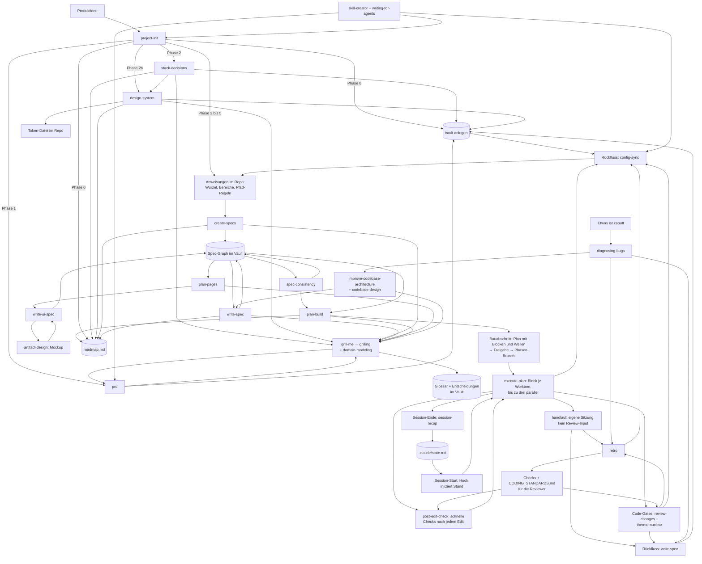

# Der Kreislauf

Wie die Skills zusammenspielen: was wann läuft, was es liest, was es hinterlässt.

Dieses Dokument beschreibt den Mechanismus. Was im Baukasten liegt und wie man es installiert, steht im [README](README.md).

---

## Das Fundament

Ein Projekt hat drei Arten von Wahrheit, und sie altern unterschiedlich schnell.

**Produktwahrheit** (was wir bauen und warum, samt der Fachsprache, in der wir darüber reden) ändert sich selten und liegt **außerhalb des Repos** im Vault. Nicht an einen Branch gebunden, nicht kopierbar, genau ein Exemplar.

**Arbeitskonventionen** (wie wir hier bauen) ändern sich mit dem Stack und liegen **in der Versionsverwaltung**, direkt neben dem Code, für den sie gelten.

**Ist-Stand** (was der Code heute tatsächlich tut) ist nur verlässlich, wenn er **aus dem Code** gelesen wird. Konfiguration darf ihn nie ohne Beleg behaupten.

Wer diese drei vermischt, bekommt Dokumentation, die verrottet. Sie zu trennen ist der ganze Zweck.

---

## Übersicht

---

## Einmalig, beim Projektstart

Hier läuft **ein** Skill: `project-init`. Er ist der Einstiegspunkt und holt sich die anderen von innen dazu. Die Phasen unten sind seine Phasen, keine getrennten Aufrufe.

### Phase 0: Wissensbasis

Vor allem anderen, auch vor dem PRD. Prüft, ob ein Obsidian-MCP verfügbar ist, führt sonst durch die Einrichtung, und legt die Vault-Struktur an: `PRD.md`, `roadmap.md`, `specs/_index.md`, `specs/decisions/`. Das Glossar `GLOSSARY.md` gehört dazu, wird aber nicht vorab angelegt, sondern erst, wenn im ersten Interview der erste Begriff geklärt ist. Bis dahin steht sein Zeiger in der Wissensbasis-Tabelle als `TBD`.

Hier wird auch die **Statuszeile** angeboten, weil das die Stelle ist, an der die rechnerweite Einrichtung ohnehin passiert. Drei Bedingungen müssen zusammenkommen: Arbeit im Terminal, noch keine `statusLine` gesetzt, und Zustimmung. Bei bereits gesetzter `statusLine` wird stillschweigend übersprungen — es ist eine Einstellung je Rechner, und in jedem neuen Projekt danach zu fragen, ist nur Lärm. Was sie liefert, ist das, was eine Sitzung sonst über sich selbst nicht weiß: verbrauchtes Limit-Fenster samt Hochrechnung, Füllstand des Kontexts, Modell und Modus, Kosten, Zustand des Arbeitsbaums. Genau die Zahlen, an denen hängt, wann übergeben wird.

Warum die Wissensbasis zuerst kommt: Das PRD braucht einen Ort, bevor es geschrieben wird. Wer es erst erzeugt und danach überlegt, wohin damit, legt es im Repo ab. Dort hängt es an einem Branch, wird irgendwann der Bequemlichkeit halber ein zweites Mal abgelegt, und ein halbes Jahr später widersprechen sich zwei Fassungen und niemand weiß, welche gilt.

### Phase 1: Produkt

Ist ein PRD da, wird es gelesen. Ist keins da, ruft `project-init` den **`prd`**-Skill auf, der wiederum **`grill-me`** zieht, das **`grilling`** ausführt.

`grilling` arbeitet einen Entscheidungsbaum in Runden ab: pro Runde alle Fragen, deren Voraussetzungen geklärt sind, jeweils mit einer Empfehlung, so formuliert, dass ein „ja“ die Empfehlung annimmt. Fakten beschafft der Agent selbst, Entscheidungen trifft der Nutzer. Fertig ist es, wenn keine offene Verzweigung mehr übrig ist.

`grill-me` zieht neben `grilling` immer auch **`domain-modeling`**, in diesem Interview und in jedem späteren, aus welchem Skill heraus es auch läuft. Siehe „Quer durch alle Interviews“ unten.

Ohne dieses Interview wird ein PRD zu dem, was der `prd`-Skill selbst „aspirational fiction" nennt: plausibel klingende Absichten ohne belastbare Aussage.

**Ergebnis:** PRD im Vault, nicht im Repo. Liegt ein vorhandenes PRD woanders, wandert es in den Vault, statt dass eine zweite Fassung entsteht.

### Phase 2: Stack

`project-init` ruft **`stack-decisions`** auf, das sein eigenes Interview über `grill-me` führt und je Entscheidung einen Datensatz in die Wissensbasis schreibt. Getrennt vom Produktgespräch.

Der Grund für die Trennung: Das PRD sagt nichts über die Technik und markiert einen unbestimmten Stack selbst als `TBD`. Regeln für einen Stack, den niemand gewählt hat, lesen sich wie richtige Regeln und werden befolgt. Nur bestätigte Technologie erzeugt technische Regeln, alles andere bleibt `TBD` mit dem Hinweis, was es klären würde.

### Phase 2b: Design-System

Nur wenn das Projekt eine Oberfläche hat. **`design-system`** läuft nach dem Stack, weil das Token-Format davon abhängt, klärt die visuelle Richtung, rendert eine Beispielseite zur Freigabe und schreibt danach zweigeteilt: **Werte in eine Token-Datei im Repo, Begründungen und Regeln in die Wissensbasis.**

Die Zweiteilung ist der Punkt. Ein Farbwert an zwei Orten driftet, und wer dann das Dokument liest, baut das Falsche. Das Dokument trägt nur, was der Code nicht sagen kann: die benannte Richtung, die Prinzipien, die verworfenen Alternativen, und Verbote wie „die Markenfarbe nie als große Fläche".

Freigegeben wird über die Beispielseite, nicht über eine Hex-Tabelle. Eine Palette auf dem Papier sagt nichts darüber, wie sie zusammen aussieht.

### Phasen 3 bis 5: Bereiche, Plan, Schreiben

Bereichskarte aus dem Stack ableiten, Plan vorlegen, nach Freigabe schreiben.

Die erzeugten Anweisungen sind danach getrennt, **wann sie in den Kontext geladen werden**: die Wurzel in jeder Sitzung, eine Bereichsdatei beim Arbeiten in ihrem Verzeichnis, eine Regel mit `paths:` beim Berühren eines passenden Pfads. Eine Regel ohne `paths:` lädt wie die Wurzel, ist also keine eigene Ebene, sondern nur ein anderer Ort für dieselbe Ebene.

**Ergebnis:** Wurzel-`CLAUDE.md`, Bereichs-`CLAUDE.md` je Bereich, `.claude/rules/` mit `paths:`-Frontmatter, und die Wissensbasis-Tabelle, die auf den Vault zeigt.

### Quer durch alle Interviews: Fachsprache und Entscheidungen

**Skill:** `domain-modeling`, gezogen von `grill-me`

Jedes Interview hinterlässt neben seinem eigentlichen Ergebnis zwei Dinge.

**Das Glossar.** Ein Agent, der die Fachsprache eines Projekts nicht kennt, umschreibt sie: zwanzig Wörter, wo eins reicht, und jedes Mal ein bisschen anders. Matt Pococks Beispiel: „ein Problem, wenn eine Lektion in einem Abschnitt eines Kurses ‚echt‘ gemacht wird, also einen Platz im Dateisystem bekommt“ gegen „ein Problem mit der Materialisierungs-Kaskade“. Das Glossar macht aus der Umschreibung ein Wort, und das Wort taucht danach in Specs, Testnamen und Code wieder auf. Deshalb wird es **während** des Gesprächs gepflegt, nicht danach: Ein Begriff, der mit dem Glossar kollidiert, wird sofort angesprochen; ein schwammiger bekommt einen genauen Namen, die verworfenen Synonyme kommen unter `_Avoid_`. Umsetzungsdetails haben darin nichts zu suchen, es ist kein zweites Spec-Dokument.

Der Nutzen zeigt sich weiter hinten. `spec-consistency` meldet einen `_Avoid_`-Begriff in einer Spec, die Struktur-Linse von `review-changes` meldet ihn im Code, `execute-plan` gibt den Subagenten die Begriffe ihres Bereichs als Inhalt mit, und `testing` benennt Tests in der Fachsprache. Namens-Drift, die `write-spec` bisher erst hinterher fand, entsteht so gar nicht erst.

**Entscheidungsdatensätze.** Nicht jede Entscheidung verdient einen. Es braucht alle drei Bedingungen: **schwer umkehrbar**, **ohne Kontext überraschend** und **Ergebnis einer echten Abwägung**. Fehlt eine, wird nichts geschrieben; wer etwas leicht Umkehrbares festhält, hält nur fest, was er nächste Woche umkehrt. Die Ausnahme ist `stack-decisions`: Stack-Entscheidungen binden immer, also wird jede geklärte Stack-Frage ein Datensatz. Format und Kriterien stehen an genau einem Ort, in `domain-modeling`; `write-spec` und `stack-decisions` verweisen darauf, statt eine eigene Vorlage zu tragen.

> **Einzeln aufrufbar bleibt alles trotzdem.** Wer nur ein PRD will, ruft `prd` direkt auf. Wer später eine Technologie tauscht, ruft `stack-decisions` direkt auf, wer ein Redesign macht `design-system`, jeweils ohne den ganzen Projektstart. `project-init` findet vorhandene Ergebnisse und setzt darauf auf, statt neu zu fragen.

---

## Danach: der Spec-Graph

### Zerlegung in Komponenten

**Skill:** `create-specs`

Bricht das Produkt in seine Software-Komponenten auf und legt sie als **verbundenen Graph** an, nicht als Ordner voller Dateien. Ergebnis: ein Index mit jeder geplanten Komponente, ein Platzhalter je Komponente am endgültigen Pfad, und die Schreibreihenfolge aus den Abhängigkeiten.

Der Schnitt ist die kleinere Hälfte. Was den Graph trägt, ist die Regel, dass **jede Komponente ausdrücklich sagt, was sie nicht abdeckt**, und wer stattdessen zuständig ist. Das ist „eine Wahrheit, ein Ort" als Dokumentstruktur. Ohne diesen Abschnitt spezifiziert jede Spec alles halb mit, und zwei Dokumente beschreiben dasselbe Feld unterschiedlich.

Die Grenzen werden **gegrillt, nicht abgeleitet**. Wo zwei Komponenten dieselbe Sache besitzen könnten, gibt es keine allgemein richtige Antwort, und genau deshalb muss sie einmal entschieden und aufgeschrieben werden statt immer wieder anders.

Die Schreibreihenfolge folgt den Verweisen: zuerst, worauf alles zeigt, also in der Regel das Datenmodell, dann die Fachlogik, dann die Verträge, zuletzt die Oberfläche. Wer den Vertrag vor den Feldern schreibt, erfindet Felder.

### Eine Komponente spezifizieren

**Skill:** `write-spec`

Ein Aufruf, ein Dokument, gegen den Code verifiziert statt aus dem Gedächtnis. Vier Prüfungen tragen ihn, und sie sind der eigentliche Wert:

**Ist-Stand nur aus Code, strukturell enumeriert.** Nicht gezielt greppen, sondern die betroffenen Bäume auflisten. Der blinde Fleck ist nie „gesucht und nichts gefunden", sondern „nicht dran gedacht zu suchen".

**Konsistenz-Check auf deklariert-gegen-erzwungen.** Ein Recht, das benutzt, aber nirgends definiert ist, oder umgekehrt tot herumliegt. Namens-Drift. Reste entfernter Features. Findet niemand, der nur fragt, was er neu baut.

**Redundanz-Sweep.** Additionen fallen von selbst auf, Redundanz nicht. Also aktiv fragen, was der Umbau überflüssig, kaputt oder inkonsistent hinterlässt. Mit der Warnung, dass falsch als redundant abstempeln genauso schädlich ist wie übersehen.

**Ripple vorwärts, Reverse-Abgleich rückwärts.** Wen berührt meine Änderung, und wer hat sich schon auf mich verlassen. Der zweite kommt aus einem Scan der eingehenden Links: Späte Komponenten werden referenziert, bevor sie existieren, also tragen die Referenzierenden Erwartungen. Die werden bestätigt oder bewusst gebrochen, nie stillschweigend unterlaufen.

Dazu die Trennschärfe bei offenen Punkten: **jetzt-entscheidbar wird gegrillt, nur-von-anderen-beantwortbar bleibt TBD mit Angabe, wer antworten muss.** Grillen heißt Entscheidungen schärfen, nicht jemanden löchern, wo das Wissen fehlt.

### Seiten planen

**Skill:** `plan-pages`

Je Oberfläche eine Übersicht: Inventar des Ist-Stands mit Pfaden, Navigationsgraph mit markierten rechte-gebundenen Kanten, Befunde ohne Bewertung, und die Ziel-Seitenliste in neu, bleibt mit Anpassungen, gestrichen.

**Abgeleitet aus den Komponenten-Specs, nicht aus dem PRD.** Das PRD sagt, was das Produkt kann; erst die Specs sagen, wie ein Arbeitstag aussieht, und Seiten folgen dem Arbeitstag. Deshalb steht dieser Schritt zwingend nach den Specs.

Der Navigationsgraph ist Pflicht, nicht Schmuck. Er ist das einzige Artefakt, das zeigt, ob eine Seite überhaupt erreichbar ist, und die markierten Kanten machen nebenbei sichtbar, wo Gating fehlt.

### Eine Seite spezifizieren

**Skill:** `write-ui-spec`, ruft `artifact-design`

Ein Aufruf, eine Seite. Der Unterschied zu jeder anderen Spec: eine Seite kann man ansehen, und das Ansehen ändert Entscheidungen. Deshalb entsteht **das Mockup vor dem Dokument**, es wird am Bild iteriert, und das Dokument hält fest, was das Ansehen überlebt hat.

Zwei Regeln machen das Mockup brauchbar: es **übersetzt** den Vorschlag in die Tokens des Design-Systems und erfindet nichts dazu, und es benutzt **echte Beispieldaten** statt Platzhaltertext. Lorem Ipsum verbirgt genau die Probleme, für die ein Mockup da ist: ein umbrechendes Label, eine zu schmale Spalte, eine Zahl, die länger ist als ihr Platz.

Der wertvollste Fund in Phase 1 ist meist ein anderer: **Specs legen UI-Verhalten fest, ohne UI zu sagen.** Sätze wie „keine Vorauswahl bei einem Vorschlag" oder „der Abschlusstext ist Pflicht im selben Schritt wie der Statuswechsel" stehen dort, weil jemand über Korrektheit nachgedacht hat, und werden übersehen, weil sie nicht unter Oberfläche abgelegt sind.

### Den Graph gegen sich selbst prüfen

**Skill:** `spec-consistency`

Findet die Klasse, die das Schreiben einer einzelnen Spec nicht fangen kann: **eine Entscheidung hat sich geändert, nachdem die Specs gegen sie geschrieben wurden.** Das fällt niemandem auf, weil nichts am Schreiben von Spec zwölf jemanden dazu bringt, Spec drei nochmal zu lesen.

**Kein fester Takt, sondern Auslöser.** Eine geänderte Entscheidung, die bestehende Specs zitieren. Ein bewusst gebrochener Annahmebruch, dessen Gegenseite noch offen ist. Ein fertiges Cluster. Und vollständig vor jedem Phasenübergang, der die Specs als Ganzes liest, also vor der Seitenplanung und vor dem Ableiten der Bauphasen. Dazu eine Zahl als Netz, nicht als Mechanismus.

Der Grund: Widersprüche entstehen durch Ändern, nicht durch Schreiben. Ein Lauf nach fünf Specs ohne Umentscheidung sucht eine Fehlerklasse, die es dort nicht gibt; ein Lauf fünf Specs nach einer geänderten Entscheidung findet den Fehler in sechs Dokumenten statt in einem.

**Nicht jeder gegen jeden.** Ein Widerspruch zwischen zwei Specs ist ein Fakt, kein zweiter. Geprüft wird gegen die Invarianten für alle, und paarweise nur entlang der **erklärten** Kanten, jede Kante genau einmal. Gleiche Abdeckung, ein Bruchteil der Last.

**Reiner Bericht, nie ein Fix.** Nachziehen läuft getrennt über `write-spec`, damit die Korrektur dieselben Prüfungen durchläuft wie das Original.

### Die Baureihenfolge ableiten

**Skill:** `plan-build`

Der Übergang vom Spezifizieren zum Bauen. Liest alle Specs auf einmal und schreibt daraus die Bauphasen in den Fahrplan.

**Schreibreihenfolge und Baureihenfolge sind verschiedene Fragen.** Schreibreihenfolge folgt den Verweisen: zuerst, worauf alles zeigt. Baureihenfolge folgt dem Nutzen: was muss existieren, bevor jemand außerhalb des Projekts etwas funktionieren sieht. Die beiden fallen selten zusammen, und keine beantwortet die andere.

Zuerst das **Abhängigkeitsgerüst** aus dem Graph, also die Fakten: was kann vor was nicht gebaut werden, jeweils mit dem Satz, der die Kante erzeugt. Das ergibt eine bewusst unvollständige Ordnung. Sie sagt, was verboten ist, nicht was gut ist.

Die eigentliche Entscheidung liegt in dem, was sie noch offen lässt, und die wird **gegrillt**: innen nach außen, senkrechte Scheiben oder Wedge zuerst. Das hängt daran, wer das erste Ergebnis sieht und wann, ob es Bestand gibt, der abgeschaltet werden muss, und was sonst zweimal gebaut würde. Aus den Specs ist das nicht ableitbar.

**Ein Gate ist eine Liste von Sätzen, die wahr oder falsch sind.** Die Prüffrage: könnte das jemand nachprüfen, der nicht mitgebaut hat? „Datenmodell sauber umgesetzt" fällt durch, „Migration läuft auf frischer und auf Dev-Datenbank durch, Schema-Diff leer" besteht. Zwei bis drei Punkte je Gate beschreiben den Weg eines Menschen durch das Produkt statt den Zustand des Codes; sie sind die, die eine technisch fertige und praktisch unbrauchbare Phase abfangen.

Dazu einmal das **Ritual je Phase**, das ab dann ohne Ausnahme gilt, die **Meilensteine** über die ganze Strecke, der **negative Umfang** und die **Entscheidungstabelle**. Die letzte ist der Teil, der zuerst verloren geht: nach zwei Monaten weiß niemand mehr, warum der Auth-Umbau in Phase 9 liegt, und ohne den Grund verschiebt ihn der Nächste, dem er im Weg ist.

Geschrieben wird das **in den Fahrplan**, nicht in ein zweites Dokument. Der Fahrplan beantwortet bereits, wo das Projekt steht; ein zweites Dokument, das dieselbe Frage genauer beantwortet, liefert zwei Antworten, die auseinanderlaufen.

---

## Je Bauabschnitt

### 4. Planen, freigeben, abzweigen

**Skill:** `planning`

Erst Planungsmodus, dann Plandatei, dann Eintrag im Fahrplan, dann Freigabe, dann Branch. In dieser Reihenfolge. Es wird nichts angefasst, bevor der Plan freigegeben ist, auch der Branch existiert vorher nicht.

Der Fahrplan nennt die **Absicht** der Phase, nicht den Weg. Wird der Weg nicht vorher festgelegt, entsteht er während des Bauens, Entscheidung für Entscheidung, an der Stelle, an der Korrekturen am teuersten sind. Der Planungsmodus erzwingt, dass zuerst gelesen und gefragt wird.

Pflichtabschnitte: Kontext, Ziel, Entscheidungen, kritische Dateien, Reihenfolge, **Blöcke**, **Wellen**, Tests, Verifikation, **Out of Scope**. Der letzte fehlt am häufigsten und ist der, der angrenzende Arbeit draußen hält.

Im Abschnitt Tests nennt jedes Testziel seine **Schnittstelle**: die öffentliche Stelle, an der getestet wird, mit einer Zeile dazu, was ein Test dort findet und was er übersieht. Mit dem Plan sind auch diese Schnittstellen freigegeben. Alles lässt sich nicht testen; wer vorher festlegt, wo, lenkt den Aufwand auf die kritischen Wege statt auf jeden Randfall.

**Blöcke und Wellen sind der Teil, den der Plan für das Bauen liefert.** Ein **Block** sind drei bis sechs Tasks, die sich einen Bereich des Codes teilen oder aufeinander aufbauen; er läuft als eine Einheit und wird einmal geprüft. Geschnitten wird **entlang des Codes, nicht entlang der Stichpunkte im Fahrplan**: Tasks, die dieselben Dateien anfassen, gehören zusammen, sonst entstehen Rebases zwischen Geschwistern. Eine **Welle** sagt, welche Blöcke gleichzeitig laufen dürfen — ihre Dateibereiche müssen disjunkt sein, und keiner darf Schema, Container-Komposition oder den laufenden Dev-Stack brauchen. Was das braucht, ist **exklusiv** und bildet eine eigene Welle.

Diese Entscheidung gehört in den Plan und nicht ins Bauen, weil nur hier noch jemand den Überblick über alle Dateien hat. Drei oder vier Wellen sind normal; zehn sind ein Zeichen, dass die Blöcke zu klein geschnitten sind.

Entscheidungen, die während des Bauens fallen, wandern **sofort** in den Entscheidungsabschnitt der Plandatei, nicht am Ende. Was am Ende nachgetragen wird, ist Rekonstruktion und nicht Protokoll.

### 5. Bauen

**Skill:** `execute-plan`, dazu Hooks nach jeder Dateiänderung

**Die Einheit ist der Block, nicht der einzelne Task.** Je Block ein **frischer Subagent**, ein **eigener git-Worktree** auf einem Block-Branch am Phasen-Branch, und **ein** Review. Bis zu drei Blöcke einer Welle laufen gleichzeitig. Der Koordinator kuratiert Kontext, verwaltet Branches und urteilt — er schreibt selbst keinen Code: Wer selbst implementiert, füllt seinen Kontext mit Detail, das in einen Subagenten gehört, und hat danach niemanden mehr mit Außensicht.

**Geschwindigkeit kommt aus weniger Übergaben, nicht aus schwächeren Prüfungen.** Jede Übergabe — Worktree, Dispatch, Review, Rebase, Merge, Testlauf — kostet Minuten. Ein Plan, der in zwanzig Einzeltasks zerfällt, zahlt das zwanzigmal; fünf Blöcke zahlen es fünfmal. Dass ein Block mit einem Review auskommt, ist nur deshalb vertretbar, weil am Phasenende die beiden Gates in voller Tiefe stehen. Das Netz rechtfertigt den Sprung, nicht umgekehrt.

Dazu gehört eine Arbeitsteilung bei den Modellen: Implementierer, Block-Reviewer und Fixer laufen auf dem **günstigeren Modell**, ausdrücklich gesetzt und nie vom Koordinator geerbt. Die Gates am Phasenende laufen auf dem **starken Modell**. Ein Netz auf dem billigen Modell macht den Tausch zunichte.

Der Block-Review beantwortet beide alten Fragen in einem Durchgang, in dieser Reihenfolge: **Spec-Treue** zuerst — ist genau das gebaut, was der Plan verlangt, und ist etwas gebaut, das er **nicht** verlangt? Der zweite Fall ist der Fund, den sonst niemand macht. **Qualität** danach, sonst wird über die Machart von etwas geurteilt, das noch das Falsche tut. Blockierend sind nur die zwei obersten Schweregrade; der Rest wird gesammelt und ans Gate übergeben, wo ein Muster sichtbar wird, das ein einzelner Block nicht zeigt.

Integriert wird in der Reihenfolge, in der Blöcke fertig werden: Rebase auf den aktuellen Phasen-Kopf, Typprüfung, Merge mit `--no-ff`, Worktree und Branch weg. Der Merge-Commit hält fest, dass dieser Block als geprüfte Einheit hereinkam. **Erst wenn alle Blöcke einer Welle drin sind**, läuft die volle Testsuite einmal auf dem Phasen-Branch — grün öffnet die nächste Welle, rot sucht den Block, der es gebrochen hat.

Was der Subagent nicht im Bündel hat, existiert für ihn nicht. Das Bündel wird aber **einmal je Phase** geschrieben und von allen Subagenten gelesen, statt in jeden Prompt kopiert zu werden. Genau das machte vorher jeden Dispatch groß und langsam. Die bindenden Regeln stehen darin als **Inhalt**, nicht als Pfad: Ein Pfad im Prompt ist eine Bitte.

Parallel dazu die **Sofortprüfung**: Der Hook `post-edit-check.py` führt nach jedem Edit die schnellen Checks aus `.claude/checks.json` aus, Typprüfung und Lint der berührten Dateien, festgelegt bei der Testing-Frage in `stack-decisions`. Schlägt einer fehl, sieht der Agent den Fehler sofort, solange die Änderung noch frisch ist. Ein Fehler, der sofort zurückkommt, kostet einen Gedanken. Derselbe Fehler zwanzig Änderungen später kostet eine Suche. Langsame Prüfungen gehören nicht hinein; die volle Suite läuft je Welle.

**Tests** folgen `testing`: kein Produktionscode ohne zuerst fehlschlagenden Test, und **Verify Red ist Pflicht**. Wer den Fehlschlag nicht gesehen hat, weiß nicht, ob der Test das Richtige prüft. Welche Fälle Pflicht sind, leitet der Skill aus dem Projekt ab statt aus einem Katalog: aus den Akzeptanzkriterien der Specs, aus den bindenden Regeln der Wurzel und aus den getroffenen Entscheidungen. Ein Verbot, das keinen Test hat, überlebt den, der es beschlossen hat, nicht. Getestet wird an den Schnittstellen aus dem Plan, gemockt nur an Systemgrenzen, und ein Erwartungswert kommt aus einer unabhängigen Quelle statt aus derselben Rechnung wie der Code. Wird ein Test auf bestehendem Code unerwartet rot, ist das kein Anlass zum Nachbessern, bis er grün ist, sondern ein Fehler, und Fehler gehen an `diagnosing-bugs`.

### 6. Abschluss-Gates

**Skills:** `handlauf`, `review-changes`, `thermo-nuclear-code-quality-review`

Am Ende eines Abschnitts, in fester Reihenfolge: Checkliste, Tests grün, **Handlauf** (wenn die Phase eine Oberfläche hat), Änderungsreview, Wartbarkeitsreview, **Retro**, Konfigurationsabgleich, Bericht.

Der **`handlauf`** kommt vor den Code-Gates, weil er eine Frage beantwortet, die kein Test und kein Review beantworten kann: Wie ist es, das zu benutzen? Er geht mit dem Browser durch die gebaute Fläche, sieht sich jede Seite und jeden Zustand wirklich an, klickt die Hauptwege und die Randfälle, beobachtet dabei Server-Log, Konsole und Netzwerk, und prüft nach dem Speichern nach, ob es wirklich gespeichert ist — ein Erfolgs-Toast ist kein Beleg. Die Specs sind dabei Orientierung, keine Checkliste: Eine Seite kann jede Anforderung erfüllen und trotzdem schief, langsam oder verwirrend sein, und genau das soll auffallen. Reiner Bericht, Befunde nach Schwere, keine Fixes — ein Lauf, der zwischendurch repariert, prüft am Ende einen Stand, den niemand gebaut hat.

**Er läuft in einer eigenen, frischen Sitzung und bekommt bewusst keinen Review-Input.** Keine Findings-Liste, kein Review-Bericht, kein Hinweis aus den Block-Reviews. Das sieht nach Verschwendung aus und ist das Gegenteil: Sein ganzer Wert liegt darin, der **erste** Blick zu sein. Wer gelesen hat, dass die Rechteprüfung im Handler in Ordnung ist, sucht die Rechteprüfung statt die Seite anzusehen; wer eine Liste mit neun Befunden mitbringt, bestätigt diese neun und übersieht den zehnten — die schiefe Spalte, die niemand notiert hat. Gelesen wird deshalb nur **Absicht**: Phasen-Plan, UI-Spec, Mockup, frühere Handlauf-Berichte. Ein Review ist dagegen schon ein Urteil, und genau das färbt ab. Die Befunde gehen an den Nutzer und in den Phasen-Plan, nicht in die Code-Gates.

Das Änderungsreview misst **nicht** allgemeine Code-Ästhetik, sondern: Tut der Code, was die Spec sagt, auf die Art, wie dieses Projekt es sonst tut? Es lädt gezielt die Specs der geänderten Pfade und fächert in **drei Linsen** auf, jede mit einem eigenen Kopf: Sicherheit, Spec-Treue, Struktur. Drei Denkweisen; zusammengelegt kostet es Tiefe, weiter aufgeteilt fallen Findings durch die Ritzen.

Die Struktur-Linse liest dabei, was das Projekt an Urteilsregeln gesammelt hat (`CODING_STANDARDS.md`), prüft Namen gegen das Glossar und hat eine feste Liste von zwölf Code-Smells nach Fowler als Heuristik dabei, jeder Fund ausdrücklich als „möglich“ markiert; dokumentierte Projektstandards haben Vorrang, und was ein Werkzeug schon prüft, wird übersprungen.

Zwei Regeln machen den Bericht belastbar. **Nachweis oder es zählt nicht:** zu jedem Finding der Pfad bis zum Schaden, der Gegenbeweis und ein Urteil. Und für die Spec-Linse die Nummer der verletzten Anforderung; ein Spec-Finding ohne Nummer ist eine Meinung. Dazu der **Gate-Abgleich** Punkt für Punkt, und ein Punkt, der ohne laufendes System nicht prüfbar ist, heißt „nicht prüfbar", nie „erfüllt".

Das letzte Gate ist **`thermo-nuclear-code-quality-review`**, und es läuft über dieselben Änderungen wie das Änderungsreview. Es fragt nicht, ob der Code richtig ist, sondern ob er in sechs Monaten noch zu ändern ist. Sein Maßstab ist bewusst unbequem: Es sucht nicht nach lokalen Aufräumgelegenheiten, sondern nach dem Umbau, der ganze Verzweigungen, Schichten oder Sonderfälle **verschwinden** lässt, statt sie umzuverteilen. Feste Schwellen gehören dazu, etwa dass eine Datei durch eine Änderung nicht ohne starken Grund über tausend Zeilen wächst, und dass neue Sonderfall-Bedingungen in fremden Abläufen ein Entwurfsproblem sind, keine Stilfrage. Die Messlatte für ein „genehmigt" ist ausdrücklich **nicht**, dass es funktioniert.

Damit sind es **drei getrennte** Gates, und das ist der Punkt. Der Handlauf fragt, ob es sich gut benutzen lässt, das Änderungsreview, ob der Code richtig ist, die Qualitätsprüfung, ob er wartbar bleibt. Drei Fragen, drei Köpfe, kein gemeinsamer Kontext.

Die beiden Code-Reviews sind untereinander ebenfalls **getrennt**, aus demselben Grund. „Richtig" und „wartbar" sind verschiedene Fragen; ein Lauf, der beide beantworten soll, beantwortet keine gründlich. Getrennte Gates halten die zweite Frage außerdem davon ab, gegen die erste wegpriorisiert zu werden — sie verliert sonst immer, weil ein Sicherheitsbefund dringender aussieht als eine wuchernde Datei.

Push erst nach ausdrücklicher Freigabe.

### 7. Rückfluss

**Skills:** `write-spec` für die Specs, `retro` für die Umgebung, `config-sync` für die Konfiguration

Der Rückfluss hat drei Empfänger. Gebaut wurde etwas, das alle betrifft: die Specs beschreiben das Soll, die Umgebung hat Fehler zugelassen, die nicht nötig waren, und die Konfiguration behauptet Dinge über den Ist-Stand. Alle drei sind nach einer Phase ein Stück falsch.

**In die Specs.** Was gebaut wurde, wird nachgezogen. Das Review liefert die Liste dafür selbst: Es findet regelmäßig Stellen, an denen **die Spec** das Problem ist und nicht der Code, und sammelt sie in einem eigenen Abschnitt „Spec-Rückfluss". Ohne den gehen diese Funde verloren, weil der Bericht sonst nur Code bewertet. Nachgezogen wird über `write-spec`, nicht im Review selbst.

**In die Umgebung.** Das ist die Stelle, an der aus einem Fehler eine Regel wird. Ohne sie wiederholt sich derselbe Fehler, bis jemand ihn zufällig erinnert. `retro` liest die Sitzung und die Berichte der Gates und fragt nicht, was falsch war, sondern was in der Umgebung es zugelassen hat. Es schlägt nur vor; geändert wird, was der Nutzer auswählt.

Jeder Kandidat wird zuerst eingeordnet, und davon hängt ab, wohin er geht:

| Fehler | Wird zu | Gelesen von |
|---|---|---|
| **Mechanisch**: ein festes Muster, eine verbotene API, eine Importform, ein Dateiort | ein **Check**: Lint-Regel, Eintrag in `.claude/checks.json`, Pre-Commit-Hook oder CI | niemandem, er schlägt einfach fehl |
| **Urteil**: Konsistenz über Dateien, „passt zum Stil drumherum“ | eine Regel in **`CODING_STANDARDS.md`** im Repo | den Reviewern, nicht den Implementierern |

Der Grund ist der **Kontextdruck**. Der Implementierer erkundet, schreibt und debuggt; jede zusätzliche Regel konkurriert mit der Arbeit und rutscht als Erstes durch. Der Reviewer bekommt einen Diff und hat den geringsten Druck von allen im Ablauf, also gehören die Standards zu ihm. Eine Regel, die ein Werkzeug durchsetzen kann, muss sich gar niemand merken. Und die Wurzel-`CLAUDE.md`, die in jeder Sitzung geladen wird, bleibt das, wofür sie da ist: Verweise und wenige bindende Regeln. Früher wanderten wiederkehrende Fehler dorthin; das ist die Gewohnheit, gegen die dieser Schritt steht.

Bei Urteilsfehlern gilt weiter: **Einmal ist ein Vorfall, zweimal ist ein Muster.** Der erste Fund steht in `CODING_STANDARDS.md` unter `## Beobachtet (einmal)`, der zweite macht daraus eine Regel. Mechanische Fehler warten nicht auf ein zweites Mal; ein Check ist billig und still, solange alles stimmt. Ein Projekt ganz ohne solche Checks ist selbst der erste Befund. `review-changes` schreibt dabei nichts, sondern sammelt nur „Kandidaten für retro“; ein Bericht, der nebenbei Regeln schreibt, ist kein reiner Bericht mehr.

**In die Konfiguration.** Die Konfiguration ist **Anweisung an ein Modell**, nicht Dokumentation für Menschen. Eine falsche Zeile darin erzeugt falschen Code, und zwar wiederholt und leise, weil sie als Wahrheit gelesen wird. Genau deshalb wird sie geprüft, nicht weil sie hübsch sein soll.

Geprüft wird jede Aussage gegen **ihre eigene** Autorität, nicht alles gegen eine:

| Art der Aussage | Zuständig |
|---|---|
| Ist-Stand: „die Funktion heißt X", „das Feld existiert" | **Der Code.** Nachsehen, nie erinnern, und nie eine Spec dafür lesen |
| Entscheidung: „wir nutzen Y nicht mehr" | **Die Entscheidungsdokumente** |
| Produkt: Zielgruppe, Umfang, bewusste Nicht-Ziele | **Die Produktdefinition** |
| Verweis nach außen: Pfad in der Wissensbasis, Werkzeugname, verlinkte Datei | **Das Verwiesene selbst.** Nachsehen, ob es existiert |

Die Prüffrage, wenn unklar ist, welche Autorität greift: *Könnte ich das durch Hinschauen widerlegen?* Wenn ja, wird hingeschaut.

Die vierte Zeile ist die, die am leichtesten vergessen wird, und sie ist teuer. Ein Verweis auf eine Notiz in der Wissensbasis, auf ein Werkzeug eines MCP-Servers oder auf eine andere Regeldatei wird beim Schreiben nicht geprüft und altert danach still. Er fällt auch nicht auf, wenn er bricht: die Sitzung sucht, findet nichts, und arbeitet mit weniger weiter, als sie hätte haben können. Wer nur Code, Entscheidungen und Produkt prüft, findet diese Klasse nie, weil sie in keine der drei fällt.

Bei Werkzeugnamen kommt eine Fußangel dazu: es zählt nur, was der **laufende** Server anbietet. Zwei Server können denselben konfigurierten Namen tragen, während nur einer verbunden ist, und ihre Werkzeuge heißen unterschiedlich. Eine Regel, die dann ein Werkzeug vorschreibt, das es auf dem laufenden Server nicht gibt, ist schlimmer als gar keine Regel.

**Wann der Lauf fällig ist**, nach derselben Regel wie bei `spec-consistency`: bei einer Änderung an dem, wovon die Konfiguration abhängt, nicht nach einem Takt.

- **Am Phasenende**, nach den Reviews und nach `retro`, vor der Freigabe. Der Hauptfall: eine Phase ändert Code, und Code ist die Autorität für die größte Klasse von Behauptungen. Nach den Reviews, weil die noch Code ändern; nach `retro`, weil das die Umgebung ändert und `CODING_STANDARDS.md` und `.claude/checks.json` genauso Konfiguration sind; vor der Freigabe, damit die Drift in demselben Bericht steht, über den entschieden wird.
- **Bei einer geänderten Entscheidung**, gezielt über die Dateien, die sie zitieren. Billig und ergiebig, wie bei den Specs.
- **Wenn ein Verweisziel umzieht.** Wissensbasis umstrukturiert, Regeldatei umbenannt, MCP-Server getauscht. Hängt an keiner Phase und wird von keinem Bauschritt ausgelöst.

**Nicht** vor einer Bauphase. Konfiguration gegen Code zu korrigieren, der in den nächsten Tagen umgebaut wird, erzeugt Arbeit, die die Phase sofort wieder entwertet.

Dieser Schritt schließt den Kreis. Ohne ihn ist alles davor eine Einbahnstraße: Konfiguration entsteht einmal und driftet danach still von dem weg, was tatsächlich gebaut wurde.

---

## Quereinstieg: etwas ist kaputt

**Skill:** `diagnosing-bugs`

Der Ablauf oben kennt eine Richtung: planen, bauen, prüfen. Fehler halten sich nicht daran. Sie tauchen zwischen den Phasen auf, im Betrieb, oder als Test, der auf altem Code plötzlich rot wird. Dafür gibt es einen eigenen Einstieg, an keine Voraussetzung im Fahrplan gebunden.

Der Kern ist eine Regel: **erst eine Rückkopplung, dann eine Theorie.** Bevor irgendjemand eine Vermutung äußert, gibt es einen Befehl, der auf genau diesen Fehler rot wird, schnell, deterministisch und ohne Menschen ausführbar: ein Test, ein `curl`, ein Browser-Skript, ein Bisektions-Lauf, im Notfall ein geführtes Skript, das den Menschen Schritt für Schritt klicken lässt. Wer ohne diesen Befehl Code liest und Theorien baut, macht genau den Fehler, den der Skill verhindert.

Danach in fester Folge: den Fall auf das kleinste Szenario schrumpfen, das noch rot wird; drei bis fünf prüfbare Hypothesen, dem Nutzer gezeigt, bevor eine getestet wird; gezielt instrumentieren, eine Variable je Probe, Debug-Ausgaben mit eindeutigem Präfix; der Regressionstest vor dem Fix, nach `testing`; aufräumen.

Zwei Ausgänge führen zurück in den Kreislauf. Gibt es keine Stelle, an der ein Regressionstest den echten Fehlerweg trifft, ist das selbst der Befund: Die Architektur verhindert, dass der Fehler festgenagelt wird, ein Fall für `improve-codebase-architecture`. Und zeigt sich, dass die Spec falsch oder stumm war, wird das als Befund für `write-spec` gemeldet, nicht im Vorbeigehen korrigiert. Nach dem Fix empfiehlt der Skill `/retro` in derselben Sitzung: Was hätte diesen Fehler verhindert?

---

## Pflege: die Architektur vertiefen

**Skills:** `improve-codebase-architecture` (nur per Hand), `codebase-design`

Agenten beschleunigen das Schreiben von Code und damit auch seinen Verfall. `thermo-nuclear-code-quality-review` hält dagegen, aber nur **reaktiv**: Es sieht den Diff einer Phase. Was sich über zehn Phasen angesammelt hat, ohne dass eine einzelne es verursacht hätte, sieht es nicht.

`improve-codebase-architecture` sucht deshalb **auf eigene Initiative** im Bestand, wann immer Zeit ist. Zuerst die Brennpunkte aus der Git-Historie, denn ein Modul zu vertiefen lohnt sich dort, wo sich ständig etwas ändert. Dann die Stellen, an denen ein Begriff über viele kleine Module verstreut ist, an denen die Schnittstelle fast so groß ist wie das, was dahinter liegt, oder an denen sich nichts sinnvoll testen lässt. Das Ergebnis ist ein HTML-Bericht mit Vorher-Nachher-Bild je Kandidat; der Nutzer wählt, dann wird gegrillt.

Ein gewählter Kandidat wird **nicht** frei umgebaut. Er geht über `write-spec` und `planning` in den normalen Ablauf, damit der Fahrplan weiß, was passiert. Entscheidungsdatensätze werden nicht neu verhandelt, und ein Kandidat, der mit tragendem Grund abgelehnt wird, wird selbst ein Datensatz, damit der nächste Lauf ihn nicht wieder vorschlägt.

Die Sprache dafür liefert `codebase-design`: **Modul**, **Schnittstelle**, **Tiefe**, **Naht**, **Adapter**, **Hebel**, **Lokalität**. Ein Modul ist tief, wenn viel Verhalten hinter einer kleinen Schnittstelle liegt. Der Löschtest prüft, ob ein Modul etwas trägt: Verschwindet mit ihm Komplexität, war es ein Durchreicher; taucht sie bei allen Aufrufern wieder auf, hat es seinen Platz verdient. Dieselben Begriffe benutzen `testing` (wo Tests ansetzen) und die Struktur-Linse von `review-changes`.

---

## Je Session

### 8. Zwei Fragen, zwei Dateien

**Wo stehen wir und was kommt als Nächstes** beantwortet der **Fahrplan** (`roadmap.md`) in der Wissensbasis. Er wird in Phase 0 aus der Vorlage neben `project-init` kopiert, noch bevor das PRD existiert, und trägt den Ablauf dieses Baukastens bereits ausgefüllt: die Schritte, den Skill je Schritt, dessen Voraussetzung, und die Regeln, die ihn ehrlich halten. Später wachsen die Bauphasen hinein, abgeleitet aus den fertigen Specs. Ein Dokument, zwei Lebensabschnitte eines Projekts, nicht zwei Dokumente.

Gepflegt wird er von den Skills selbst: wer einen Schritt abschließt, trägt ihn ein. Und die Wurzel-`CLAUDE.md` nennt ihn ausdrücklich als **den** Ort für den Status, samt der Pflicht, ihn aktuell zu halten. Beides ist nötig. Ohne den Verweis schaut niemand hin, ohne die Pflicht wird er zum Tagebuch der ersten Woche.

**Er sagt auch, was noch nicht dran ist.** Jeder Schritt nennt seine Voraussetzung, und der Kopf trägt die Regel dazu: Bevor ein Skill des Ablaufs läuft, wird seine Zeile gelesen; steht die Voraussetzung noch offen, wird er **nicht** ausgeführt, sondern der fehlende Schritt benannt und angeboten.

Das ist die Antwort auf den häufigsten Fehlgriff, und der ist nicht der falsche Skill, sondern der richtige zu früh. Er fällt auch nicht auf, weil das Ergebnis aussieht wie ein Ergebnis — eine Spec, die auf Entscheidungen aufbaut, die niemand getroffen hat, liest sich wie jede andere. Und er kommt fast immer über eine Bitte, die nach dem **Ergebnis** fragt statt nach dem Schritt: Niemand verlangt Schritt 7, alle verlangen die Spec für X. Deshalb steht dieser Fall ausdrücklich in der Regel.

Die Reihenfolge steht dabei nur an einer Stelle, nämlich im Fahrplan. Die Wurzel-`CLAUDE.md` verweist darauf, statt sie zu wiederholen, und der SessionStart-Hook wiederholt die **Regel** in seiner Anweisung — nicht die Reihenfolge selbst —, damit sie auch in einer Sitzung greift, die die Wurzel nie zu sehen bekommt.

**Was war letzte Sitzung** beantwortet `.claude/state.md` im Repo, geschrieben von `session-recap`.

Beide werden vom SessionStart-Hook **injiziert**, nicht nur erwähnt, samt der Anweisung, die Sitzung mit Standort und Vorschlag zu eröffnen statt auf eine Frage zu warten. Eine Anweisung, eine Datei zu lesen, ist eine Bitte; injizierter Inhalt liegt einfach da. Der Fahrplan lebt außerhalb des Repos, deshalb schreibt `project-init` seinen Pfad beim Installieren nach `.claude/roadmap-path`.

**Er wächst, und ab einer Größe wird nicht mehr alles injiziert.** In der Aufbauphase ist der Fahrplan kurz und geht ganz in die Sitzung. Sobald die Bauphasen darin stehen, passt er nicht mehr: ein ausgewachsener Fahrplan erreicht leicht 60.000 Zeichen und mehr. Stumpfes Abschneiden wäre hier der schlimmste Fehlermodus, weil abgeschnittener Inhalt in der Sitzung genauso aussieht wie vollständiger. Deshalb trägt der Kopf die Zeile `**Aktuelle Bauphase:**`, und der Hook injiziert von da an **den Kopf und genau den Abschnitt, dessen Überschrift diesen Text enthält**. Die übrigen Phasen bleiben lesbar, sie liegen nur nicht mehr in jeder Sitzung herum. Der Preis ist eine Zeile, die stimmen muss: zeigt sie auf die falsche Phase, arbeitet die nächste Sitzung mit der falschen Phase, ohne dass etwas fehlschlägt. Sie wird beim Phasenwechsel gesetzt, im selben Zug wie „Jetzt".

Die Trennung ist der Punkt. Der Fahrplan ändert sich selten, die Übergabe jedes Mal. Wer beides mischt, begräbt das Dauerhafte unter dem Flüchtigen. Und der Fahrplan fasst nichts zusammen, was anderen gehört: der Spec-Index besitzt den Status je Spec, der Fahrplan zeigt nur darauf, und beim Widerspruch gewinnt der Index.

Als Nächstes trägt in beiden eine Handlung, keinen Phasennamen. Specs schreiben sagt nichts; zuerst das Datenmodell, alles andere zeigt darauf sagt, wo man anfängt und warum. Genau diese Begründung ist nach ein paar Tagen weg.

---

## Laufend

### 9. Werkzeuge verbessern

**Skill:** `skill-creator`

Baut neue Skills, verbessert bestehende, misst Trefferquote der Auslöser. Das Werkzeug, mit dem der Baukasten sich selbst erweitert. Nur per Hand aufrufbar (`/skill-creator`): Er wird selten gebraucht, und seine Beschreibung kostete sonst in jeder Sitzung Kontext.

**Skill:** `writing-for-agents`

Die Schreibregeln für alles, was ein Agent liest: Skills, `CLAUDE.md`, Regeln, Dokumente hinter einem Verweis. Ein paar davon tragen den ganzen Baukasten. **Jede Zeile, die immer geladen wird, kostet in jeder Sitzung**, also verdient sie härteres Kürzen als alles andere. **Leitwörter** statt Umschreibungen: Ein Wort, das das Modell schon kennt (*rot*, *Leuchtspur*), trägt mehr als ein Satz. **Positiv formulieren**: Ein Verbot holt das Verbotene in den Kontext. **No-ops streichen**: Ein Satz, der nichts an dem ändert, was das Modell ohnehin täte, kostet nur. Gezogen wird der Skill von `config-sync` und `retro`, wann immer sie Anweisungen schreiben.

Wo Skills einander brauchen, rufen sie sich über das Skill-Werkzeug auf („Call the Skill tool with …“) und schreiben einander nicht ab. Eine Regel, die zwei Skills brauchen, steht in einem von beiden.

---

## Zwei Regeln über allem

**Eine Wahrheit, ein Ort.** Keine Aussage steht in zwei Dateien. Wo eine zweite sie braucht, verweist sie. Zwei Kopien einer Regel werden irgendwann uneins, und dann folgt die Arbeit der falschen.

**Bestand mit Ablaufdatum.** Was noch läuft, aber abgelöst wird, sagt das in seinem eigenen Dokument: was heute gilt, was es ersetzt, welche Entscheidung das festgelegt hat, und worauf nicht mehr aufgebaut werden darf. Dokumentation, die ein sterbendes System als Zielbild beschreibt, bringt jeder Sitzung still das Falsche bei.

---

## Stand des Baukastens

Ehrlich, weil ein Kreislauf mit Lücke kein Kreislauf ist.

| Baustein | Zweck | Stand |
|---|---|---|
| `prd` | Produkt spezifizieren | vorhanden |
| `stack-decisions` | Technische Entscheidungen treffen und festhalten | vorhanden |
| `design-system` | Visuelle Richtung klären, Tokens schreiben, Beispielseite | vorhanden |
| `create-specs` | Produkt in Komponenten zerlegen, Spec-Graph anlegen | vorhanden |
| `write-spec` | Eine Komponente je Aufruf, gegen Code verifiziert | vorhanden |
| `plan-pages` | Je Oberfläche eine Seitenübersicht mit Navigationsgraph | vorhanden |
| `write-ui-spec` | Eine Seite je Aufruf, Mockup vor dem Dokument | vorhanden |
| `spec-consistency` | Den Graph gegeneinander und gegen die Produktwahrheit prüfen | vorhanden |
| `plan-build` | Baureihenfolge mit Gates aus den fertigen Specs ableiten | vorhanden |
| `grill-me` → `grilling` + `domain-modeling` | Interview-Verfahren, pflegt Glossar und Entscheidungsdatensätze | vorhanden |
| `domain-modeling` | Fachsprache im Glossar, Format und Kriterien der Entscheidungsdatensätze | vorhanden |
| `project-init` | Konfiguration aufbauen | vorhanden |
| `skill-creator` | Skills bauen und messen, nur per Hand | vorhanden |
| `writing-for-agents` | Schreibregeln für alles, was ein Agent liest | vorhanden |
| `claude-statusbar` | Statuszeile im Terminal, optional in Phase 0 angeboten, nur per Hand | vorhanden |
| `config-sync` | Konfiguration gegen ihre vier Autoritäten prüfen und nachziehen | vorhanden |
| Fahrplan als Statusquelle | `skills/project-init/templates/roadmap.md`, vorbefüllt, in Phase 0 kopiert | vorhanden |
| Übergabe + Hooks | `.claude/state.md`; Hook injiziert Fahrplan und Übergabe | vorhanden |
| `session-recap` + Hook | Handoff am Sitzungsende, Abschiedsformeln als Auslöser | vorhanden |
| `planning` | Plan je Phase, im Planungsmodus, vor dem Branch, mit Blöcken und Wellen | vorhanden |
| `execute-plan` | Plan abarbeiten, Block je Worktree, bis zu drei parallel, ein Review je Block | vorhanden |
| `testing` | Testdisziplin, Verify Red, Pflichtfälle aus dem Projekt abgeleitet | vorhanden |
| `handlauf` | Fläche im Browser durchgehen, eigene Sitzung ohne Review-Input, reiner Bericht | vorhanden |
| `review-changes` | Code-Gate am Phasenende, drei Linsen, Gate-Abgleich, reiner Bericht | vorhanden |
| `thermo-nuclear-code-quality-review` | Zweites, getrenntes Gate: Wartbarkeit statt Korrektheit | vorhanden |
| `retro` | Umgebung nach der Phase verbessern: Checks für Mechanisches, `CODING_STANDARDS.md` für Urteile | vorhanden |
| `diagnosing-bugs` | Quereinstieg bei Fehlern: erst eine rote Rückkopplung, dann Theorien | vorhanden |
| `codebase-design` | Vokabular tiefer Module für Tests, Reviews und Architekturarbeit | vorhanden |
| `improve-codebase-architecture` | Pflege: Bestand nach Vertiefungskandidaten absuchen, nur per Hand | vorhanden |
| Sofortprüfung | `post-edit-check.py` führt `.claude/checks.json` nach jedem Edit aus | vorhanden |

Was heute steht, trägt den ganzen Weg von der Idee bis zum Ende einer Bauphase und wieder zurück in Specs, Umgebung und Konfiguration, dazu den Quereinstieg für Fehler und die Pflege der Architektur. Die Sofortprüfung nach jedem Edit bringt `project-init` jetzt selbst mit; welche Befehle sie ausführt, entscheidet `stack-decisions` je Projekt.
